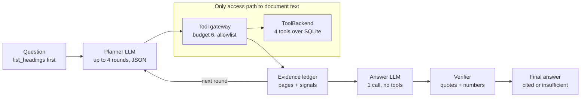

# Memo: PageTurner, a Budgeted Document-Answering Agent

**Track:** AI/ML, Agentic Systems and Harness Design | **Team of 2**

## 1. Architecture

A plain-Python controller wraps an LLM that only proposes JSON actions: the LLM is a policy, not an authority. Per question, `list_headings` runs first (call 1, no LLM). The planner (up to 4 rounds) requests searches and page reads; the gateway validates and executes them under a hard budget of 6, and an evidence ledger built only from tool outputs is fed back. One final answer call (no tools) is then checked by a verifier that confirms every quote appears in a page fetched in this run; otherwise the answer is downgraded to insufficient information. No agent framework is used.

Text version of the diagram (renders in GitHub, VS Code, Obsidian)

## 2. What we did and why

| Choice | Why / what it prevents |
|---|---|
| Budget enforced in gateway code, not the prompt | Models miscount. The 7th call is impossible, not just discouraged; an adversarial fake-LLM test spams 50 actions. |
| Controller owns `doc_id`; allowlist + schema checks | Injected text cannot add tools, switch documents, or request page ranges. |
| `list_headings` first | Cheapest orientation; resolves cross-references without extra calls. |
| Bracketing, amendment sweep, reserved 6th call | Contradiction and supersession: read earliest and latest hit, then check amendment or errata sections. |
| Authority order in the answer prompt | Explicit supersession, errata, later date, scoped amendment, specific over general. If unresolved, do not pick a side. |
| Verbatim-quote and numeric verifier | Hallucination control; abstention becomes a measurable outcome, not a model mood. |
| Page text treated as untrusted data + injection detector | Defense in depth: delimiters, schema-validated output, echo check on the answer. |
| Per-run state, no cross-question page cache | Respects the intent of the budget. |
| Import-boundary test and full trace | Shows the agent has no side channel to raw text; nothing hidden. |
| Heading cascade: bookmarks, font heuristics, first line per page | Generalizes to unseen PDFs that have no table of contents. |

*Interpretation: only executed document-tool calls count toward the 6; planner rounds are capped at 4 and fully logged.*

## 3. Known failure modes (not fully fixed)

1. **Vocabulary mismatch.** Search is lexical, so "vacation" vs "annual leave" can return `[]`. Fix: LLM proposes 2–3 keyword variants, one tried per call; match heading titles first. Not fully solvable in 6 calls.
2. **Questions needing more than ~4 pages** (e.g. "list all deadlines") exceed the budget; we return `partial` with explicit coverage.
3. **Scanned PDFs** have no text layer, so pages come back empty. Fix: OCR fallback in ingestion behind a flag.
4. **Tables split across pages or merged columns** can misalign values. Fix: table-aware extraction and reading the continuation page.
5. **Overrides with no cue words, or in unrelated sections,** can be missed; the unread-later-hits signal helps but a full fix needs more calls.
6. **Weak heading detection on messy layouts** lowers page targeting; synthetic headings are coarse.
7. **The verifier is lexical:** a correct but paraphrased figure ("twice the limit") may be wrongly downgraded. Fix: extend the safe-arithmetic check.
8. **Broad keywords that hit most pages** waste a call; the ledger flags them but the planner can still choose them.
9. **Budget ambiguity:** if planner LLM calls count toward 6, we would collapse to one planning round (config flag), at some cost in accuracy.

## 4. Measured results

Accuracy on the 14-question demo set, 3 runs: **[7.7/14]** (Run 1: 11/14, Run 2: 6/14, Run 3: 6/14). Budget compliance: **[100.0%]**. Abstention correctness: **[4/6]**. Injection resilience: **[100% safe, 1/3 flagged]**. Median latency: **[7.42 s]**.
